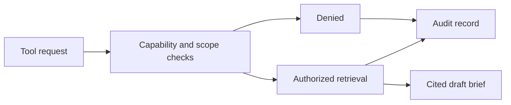

# PHAROS Agent — Cited Briefs with Explicit Tool Permissions

PHAROS Agent retrieves from registered sources, prepares a cited work brief, and saves a local draft. Capability grants constrain what each tool can access or do, while an audit ledger records the work.

**Stack:** Next.js, TypeScript, React, Prisma, PostgreSQL, and Vitest.

## Permission and brief flow



## Engineering highlights

- Permissions are application data checked in code before tool execution.
- Source and path restrictions bound retrieval and draft creation.
- Briefs retain citations and draft status.
- Tests check that every registered tool refuses execution when its grant is revoked.
- Database rules support an append-only audit ledger.

## Review the implementation

| Question | Start here |
| --- | --- |
| How are capabilities and resource scopes enforced? | [Policy](src/lib/policy.ts), [policy tests](tests/policy.test.ts) |
| Can a newly added tool escape the permission check? | [Registry-wide gating tests](tests/registryGating.test.ts) |
| How is retrieval evaluated? | [Retrieval tests](tests/retrieval.test.ts) |
| What prevents unauthorized draft writes? | [Write-path tests](tests/writePath.test.ts) |
| Where is the operating contract? | [Agent contract](docs/PHAROS-AGENT-CONTRACT.md) |

A focused demonstration uses synthetic documents: grant access to one source, retrieve a cited brief, revoke the capability, and inspect the resulting denial and audit entry.

## Development and verification

```sh
npm install
npm run dev
```

Configure a dedicated PostgreSQL database and registered sources first. This project currently includes machine-specific source paths and optional local voice integration; it is not a portable one-command install.

`npm test` runs the Vitest suite. Database-backed tests create and drop their test database, so use the documented isolated test configuration. `npm run build` is available; avoid building into the same output directory as a running development instance.

## Scope

Calendar retrieval is a stub. Synthesis can use a configured external provider; retrieved excerpts may then leave the machine. Without that configuration, the documented deterministic template path is used. The optional voice service is separate from the core brief workflow.

[Detailed setup and operating guide](https://github.com/martinlepage26-bit/pharos-agent-web/blob/3b67ffc2efdda52264957015eebf56fcf5003e57/README.md)
